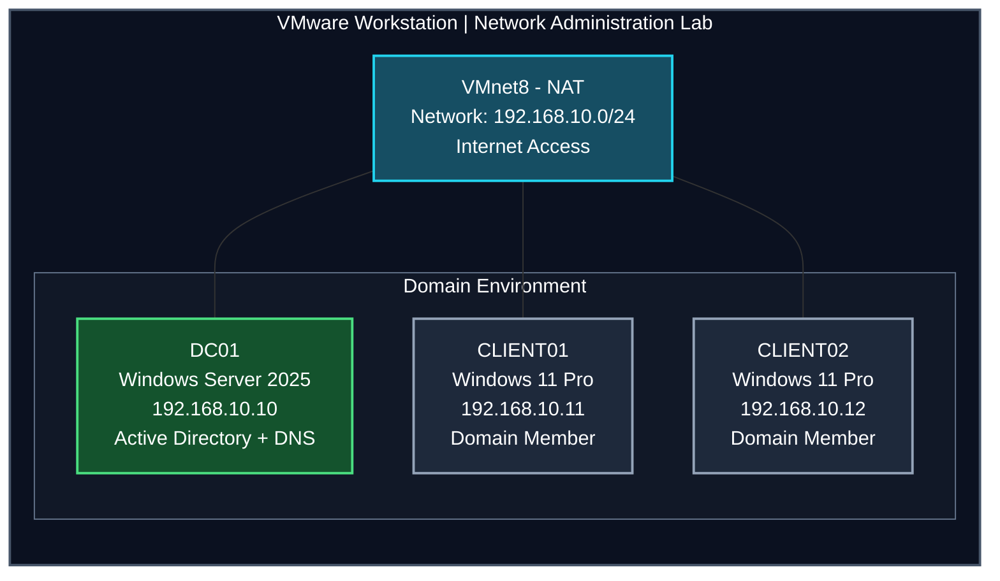

<h1 align="center"> VMnet as isolated network </h1>

---

## Lab Topology

VMware Workstation to build an isolated network environment for practicing Windows Server administration, Active Directory Domain Services (AD DS), DNS, and Windows domain management.

### Network Diagram

### Network Diagram

### Network Configuration

| Component               | Configuration                |
| ----------------------- | ---------------------------- |
| Virtualization Platform | VMware Workstation           |
| Virtual Network         | VMnet2                       |
| Network Type            | Host-only                    |
| Subnet                  | `192.168.10.0/24`            |
| Domain Name             | `Net.com`                    |
| Domain Controller       | `DC01`                       |
| Domain Controller IP    | `192.168.10.10`              |
| Client 1                | `CLIENT01` — `192.168.10.11` |
| Client 2                | `CLIENT02` — `192.168.10.12` |
| DNS Server              | `192.168.10.10`              |

