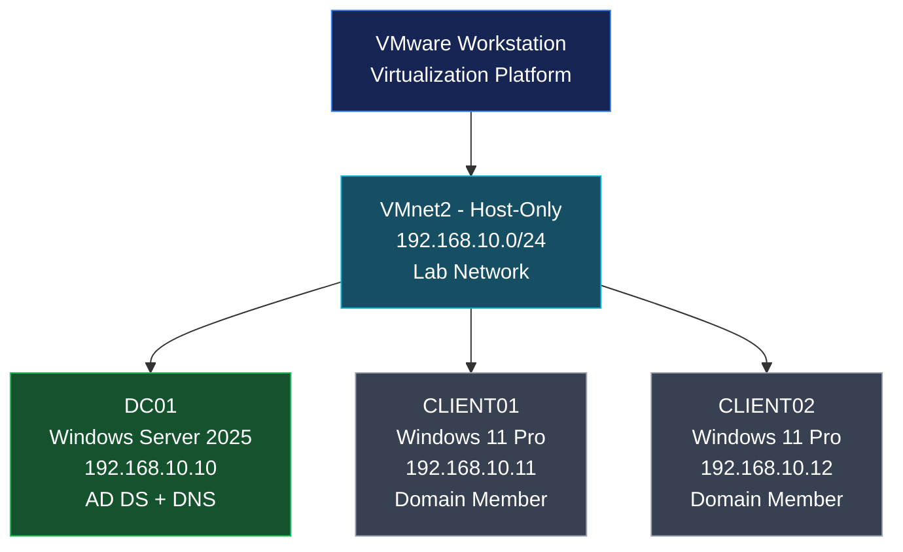

<h1 align="center"> VMnet as isolated network </h1>

---

## Lab Topology

VMware Workstation to build an isolated network environment for practicing Windows Server administration, Active Directory Domain Services (AD DS), DNS, and Windows domain management.

### Network Diagram

### Network Configuration

| Component               | Configuration                |
| ----------------------- | ---------------------------- |
| Virtualization Platform | VMware Workstation           |
| Virtual Network         | VMnet2                       |
| Network Type            | Host-only                    |
| Subnet                  | `192.168.10.0/24`            |
| Domain Name             | `Net.com`                    |
| Domain Controller       | `DC01`                       |
| Domain Controller IP    | `192.168.10.10`              |
| Client 1                | `CLIENT01` — `192.168.10.11` |
| Client 2                | `CLIENT02` — `192.168.10.12` |
| DNS Server              | `192.168.10.10`              |

---

## Configure the network

In **VMware Workstation**:

After click on **Change Settings**:

> **Note**: Make sure we don't click anything in VMnet that we was config.

> **Note**: In this if after we click on `Change Settings` if it show Bluetooth just click `Yes`.

Click on **Add Network**:

Then select **VMnet**:

Also in this I select `VMnet2`:

Show in this we choose **Host-Only** for isolate network.

Then setup it to:
| Setting     | Value           |
| ----------- | --------------- |
| Network     | VMnet2          |
| Type        | Host-only       |
| Subnet IP   | `192.168.10.0`  |
| Subnet Mask | `255.255.255.0` |

Now we completed setup it.

---
