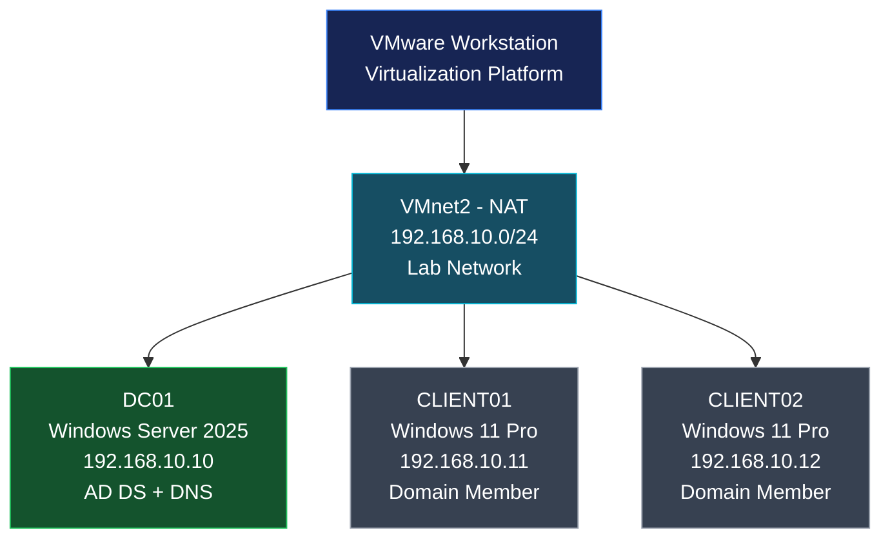

<h1 align="center"> VMnet as isolated network </h1>


---


## Lab Topology

VMware Workstation to build an isolated network environment for practicing Windows Server administration, Active Directory Domain Services (AD DS), DNS, and Windows domain management.


### Network Diagram


````mermaid
flowchart TB
    A["VMware Workstation<br/>Virtualization Platform"]
    A --> B["VMnet2 — Host-only<br/>192.168.10.0/24<br/>Private Lab Network"]

    B --> C["DC01<br/>Windows Server 2025<br/>192.168.10.10<br/>AD DS + DNS"]
    B --> D["CLIENT01<br/>Windows 11 Pro<br/>192.168.10.11<br/>Domain Member"]
    B --> E["CLIENT02<br/>Windows 11 Pro<br/>192.168.10.12<br/>Domain Member"]
````


You can write this topology in Markdown using Mermaid, which renders a diagram automatically on platforms such as GitHub that support Mermaid.

Copy this into your `README.md` file.

# Network System Administration Lab

## 1. Lab Topology

This lab uses VMware Workstation to build an isolated network environment for practicing Windows Server administration, Active Directory Domain Services (AD DS), DNS, and Windows domain management.

### Network Diagram


### Network Diagram



### Network Configuration

| Component               | Configuration                |
| ----------------------- | ---------------------------- |
| Virtualization Platform | VMware Workstation           |
| Virtual Network         | VMnet2                       |
| Network Type            | Host-only                    |
| Subnet                  | `192.168.10.0/24`            |
| Domain Name             | `Net.com`                    |
| Domain Controller       | `DC01`                       |
| Domain Controller IP    | `192.168.10.10`              |
| Client 1                | `CLIENT01` — `192.168.10.11` |
| Client 2                | `CLIENT02` — `192.168.10.12` |
| DNS Server              | `192.168.10.10`              |


