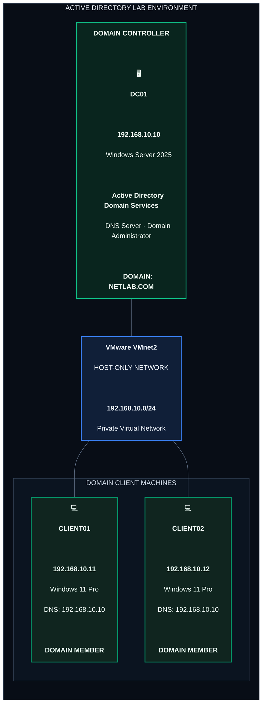

<h1 align="center"> Configure Static IP Address </h1>

---

## Introduction

A **Static IP Address** is an IP address manually assigned to a computer or server instead of being automatically assigned by a DHCP server.

In an Active Directory environment, configuring a static IP address on a Domain Controller is important because client computers need to communicate with the Domain Controller consistently.

A Domain Controller also provides important network services, including Active Directory Domain Services (AD DS) and DNS.

---

## Lab Walkthrough 

### Architecture

# Part 1. Final Lab Architecture

This diagram represents the Active Directory infrastructure running on VMware Workstation, including one Domain Controller and two Windows 11 domain clients.

