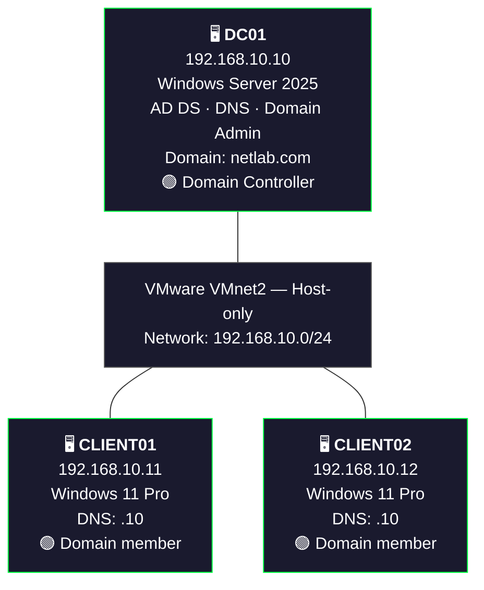

<h1 align="center"> Configure Static IP Address </h1>

---

## Introduction

A **Static IP Address** is an IP address manually assigned to a computer or server instead of being automatically assigned by a DHCP server.

In an Active Directory environment, configuring a static IP address on a Domain Controller is important because client computers need to communicate with the Domain Controller consistently.

A Domain Controller also provides important network services, including Active Directory Domain Services (AD DS) and DNS.

---

## Lab Walkthrough 

### Architecture

| Configuration | DC01 | CLIENT01 | CLIENT02 |
|---|---|---|---|
| OS | Server 2025 | Windows 11 Pro | Windows 11 Pro |
| Hostname | DC01 | CLIENT01 | CLIENT02 |
| IP | 192.168.10.10 | 192.168.10.11 | 192.168.10.12 |
| Subnet | /24 | /24 | /24 |
| Subnet Mask | 255.255.255.0 | 255.255.255.0 | 255.255.255.0 |
| Gateway | Blank | Blank | Blank |
| Preferred DNS | 192.168.10.10 | 192.168.10.10 | 192.168.10.10 |
| Domain | netlab.com | netlab.com | netlab.com |

