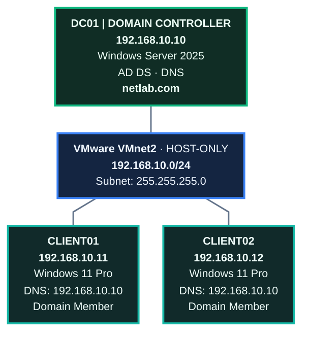

<h1 align="center"> Configure Static IP Address </h1>


---

## Introduction

A **Static IP Address** is an IP address manually assigned to a computer or server instead of being automatically assigned by a DHCP server.

In an Active Directory environment, configuring a static IP address on a Domain Controller is important because client computers need to communicate with the Domain Controller consistently.

A Domain Controller also provides important network services, including Active Directory Domain Services (AD DS) and DNS.


---

### Architecture




| Configuration | Windows Server | CLIENT01 | CLIENT02 |
|---|---|---|---|
| Computer Name | Existing DC hostname | CLIENT01 | CLIENT02 |
| OS | Windows Server 2025 | Windows 11 Pro | Windows 11 Pro |
| IP Address | `192.168.10.10` | `192.168.10.11` | `192.168.10.12` |
| Subnet Mask | `255.255.255.0` | `255.255.255.0` | `255.255.255.0` |
| Default Gateway | Blank | Blank | Blank |
| Preferred DNS | `192.168.10.10` | `192.168.10.10` | `192.168.10.10` |
| Domain | `netlab.com` | `netlab.com` | `netlab.com` |
| VMware Network | VMnet2 | VMnet2 | VMnet2 |


---


## Lab Walkthrough 


### VMware Workstation preparation

Before configuring Windows, check your VMware network.


#### Configure VMnet2


Make sure like this:


Now we completed.

---


### Windows Server 2025 - DC01

#### Check your current IP address

Open **Command Prompt** as **Administrator**:

````cmd
ipconfig /all
````
**Output:**
````cmd
Windows IP Configuration

   Host Name . . . . . . . . . . . . : WIN-UFA6918U7CF
   Primary Dns Suffix  . . . . . . . : netlab.com
   Node Type . . . . . . . . . . . . : Hybrid
   IP Routing Enabled. . . . . . . . : No
   WINS Proxy Enabled. . . . . . . . : No
   DNS Suffix Search List. . . . . . : netlab.com
                                       localdomain

Ethernet adapter Ethernet0:

   Connection-specific DNS Suffix  . : localdomain
   Description . . . . . . . . . . . : Intel(R) 82574L Gigabit Network Connection
   Physical Address. . . . . . . . . : 00-0C-29-65-DB-F7
   DHCP Enabled. . . . . . . . . . . : Yes
   Autoconfiguration Enabled . . . . : Yes
   Link-local IPv6 Address . . . . . : fe80::aac:9618:6b09:f24%14(Preferred)
   IPv4 Address. . . . . . . . . . . : 192.168.10.128(Preferred)
   Subnet Mask . . . . . . . . . . . : 255.255.255.0
   Lease Obtained. . . . . . . . . . : Friday, October 30, 2026 2:11:34 AM
   Lease Expires . . . . . . . . . . : Friday, October 30, 2026 2:41:34 AM
   Default Gateway . . . . . . . . . :
   DHCP Server . . . . . . . . . . . : 192.168.10.254
   DHCPv6 IAID . . . . . . . . . . . : 100666409
   DHCPv6 Client DUID. . . . . . . . : 00-01-01-00-32-72-13-EE-00-0C-29-65-DB-F7
   DNS Servers . . . . . . . . . . . : ::1
                                       127.0.0.1
   NetBIOS over Tcpip. . . . . . . . : Enabled
````


So in this my current IP is `192.168.10.128`.


---


#### Open Network Connections

Press `Windows + R`, then type:
````
ncpa.cpl
````


In this we can click **OK** or press **Enter**.

---

#### Open Ethernet adapter properties

The `Right-Click` on our `Ethernet0`:


Then `Double-Click` on **Internet Protocol Version 4 (TCP/IPv4)**:


In this I use:

| Setting | Configuration |
|---|---|
| IP Configuration | Use the following IP address |
| IP Address | `192.168.10.10` |
| Subnet Mask | `255.255.255.0` |
| Default Gateway | Blank |
| DNS Configuration | Use the following DNS server addresses |
| Preferred DNS Server | `192.168.10.10` |
| Alternate DNS Server | Blank |


---

#### Refresh DNS registration

In this we changed the IP address of an existing Domain Controller, refresh its DNS information.


Open **PowerShell** as **Administrator**:

##### Clear DNS cache
````cmd
ipconfig /flushdns
````
**Output:**
````cmd
Windows IP Configuration

Successfully flushed the DNS Resolver Cache.
````


##### Register DNS
````cmd
ipconfig /registerdns
````
**Output:**
````cmd
Windows IP Configuration

Registration of the DNS resource records for all adapters of this computer has been initiated. Any errors will be reported in the Event Viewer in 15 minutes.
````


##### Register Domain Controller DNS records

````cmd
nltest /dsregdns
````
**output:**
````cmd
Flags: 0
Connection Status = 0 0x0 NERR_Success
The command completed successfully
````


##### Restart Netlogon
In this open **Powershell** as **Administrator**:

````ps1
Restart-Service Netlogon
````
**output:**
````cmd
WARNING: Waiting for service 'Netlogon (Netlogon)' to start...
````


> These commands help refresh the server's DNS registration and Domain Controller locator records.


Then check status:
````
Get-Service Netlogon
````
**Output:**
````ps1
Status   Name               DisplayName
------   ----               -----------
Running  Netlogon           netlogon
````

So in this **Netlogon** is Running.

---

##### Verify Domain Controller discovery
Om **Powershell**:
````
nltest /dsgetdc:netlab.com
````
**Output:**
````ps1
           DC: \\WIN-UFA6918U7CF.netlab.com
      Address: \\192.168.10.10
     Dom Guid: f773b021-10da-4ce7-85fb-df9cc2761306
     Dom Name: netlab.com
  Forest Name: netlab.com
 Dc Site Name: Default-First-Site-Name
Our Site Name: Default-First-Site-Name
        Flags: PDC GC DS LDAP KDC TIMESERV GTIMESERV WRITABLE DNS_DC DNS_DOMAIN DNS_FOREST CLOSE_SITE FULL_SECRET WS DS_8 DS_9 DS_10 KEYLIST DS_13
The command completed successfully
````

Now we got successful.

---


##### Verify the server IP
````
ipconfig /all
````
**Output:**
````ps1
Windows IP Configuration

   Host Name . . . . . . . . . . . . : WIN-UFA6918U7CF
   Primary Dns Suffix  . . . . . . . : netlab.com
   Node Type . . . . . . . . . . . . : Hybrid
   IP Routing Enabled. . . . . . . . : No
   WINS Proxy Enabled. . . . . . . . : No
   DNS Suffix Search List. . . . . . : netlab.com

Ethernet adapter Ethernet0:

   Connection-specific DNS Suffix  . :
   Description . . . . . . . . . . . : Intel(R) 82574L Gigabit Network Connection
   Physical Address. . . . . . . . . : 00-0C-29-65-DB-F7
   DHCP Enabled. . . . . . . . . . . : No
   Autoconfiguration Enabled . . . . : Yes
   Link-local IPv6 Address . . . . . : fe80::aac:9618:6b09:f24%14(Preferred)
   IPv4 Address. . . . . . . . . . . : 192.168.10.10(Preferred)
   Subnet Mask . . . . . . . . . . . : 255.255.255.0
   Default Gateway . . . . . . . . . :
   DHCPv6 IAID . . . . . . . . . . . : 100666409
   DHCPv6 Client DUID. . . . . . . . : 00-01-01-00-32-72-13-EE-00-0C-29-65-DB-F7
   DNS Servers . . . . . . . . . . . : ::1
                                       192.168.10.10
   NetBIOS over Tcpip. . . . . . . . : Enabled
````

---

##### Verify the DNS records

Open **Server Manager** → **Tools** → **DNS**:


So in this it also confirm.


Now we got successful.
----


### CLIENT01

We want to change **CLIENT01** to:
````
192.168.10.11
````


In this check current IP, open **Command Prompt**:

````cmd
C:\Windows\System32> ipconfig

Windows IP Configuration


Ethernet adapter Ethernet0:

   Connection-specific DNS Suffix  . : localdomain
   Link-local IPv6 Address . . . . . : fe80::c41:5730:a32a:3c86%9
   IPv4 Address. . . . . . . . . . . : 192.168.10.129
   Subnet Mask . . . . . . . . . . . : 255.255.255.0
   Default Gateway . . . . . . . . . :
````

So in this my current IP is `192.168.10.129`.


#### Configure CLIENT01 IPv4 and DNS

Press `Windows + R`, then:
````
ncpa.cpl
````
Then press **Enter**:


`Double-Click` on **Internet Protocol Version 4 (TCP/IPv4)**:


| Field | Value |
|---|---|
| IP Address | `192.168.10.11` |
| Subnet Mask | `255.255.255.0` |
| Default Gateway | Blank |
| Preferred DNS | `192.168.10.10` |
| Alternate DNS | Blank |


---


#### Verify CLIENT01

Open **Command Prompt**:
````cmd
C:\Users\k4n0ng> ipconfig /all

Windows IP Configuration

   Host Name . . . . . . . . . . . . : DESKTOP-818QI41
   Primary Dns Suffix  . . . . . . . :
   Node Type . . . . . . . . . . . . : Hybrid
   IP Routing Enabled. . . . . . . . : No
   WINS Proxy Enabled. . . . . . . . : No

Ethernet adapter Ethernet0:

   Connection-specific DNS Suffix  . :
   Description . . . . . . . . . . . : Intel(R) 82574L Gigabit Network Connection
   Physical Address. . . . . . . . . : 00-0C-29-22-0B-FA
   DHCP Enabled. . . . . . . . . . . : No
   Autoconfiguration Enabled . . . . : Yes
   Link-local IPv6 Address . . . . . : fe80::c41:5730:a32a:3c86%9(Preferred)
   IPv4 Address. . . . . . . . . . . : 192.168.10.11(Preferred)
   Subnet Mask . . . . . . . . . . . : 255.255.255.0
   Default Gateway . . . . . . . . . :
   DHCPv6 IAID . . . . . . . . . . . : 100666409
   DHCPv6 Client DUID. . . . . . . . : 00-01-00-01-32-76-08-48-00-0C-29-22-0B-FA
   DNS Servers . . . . . . . . . . . : 192.168.10.10
   NetBIOS over Tcpip. . . . . . . . : Enabled
````

Now we got `192.168.10.11`.

---


#### Test communicate to Windows server

````cmd
C:\Users\k4n0ng> ping 192.168.10.10

Pinging 192.168.10.10 with 32 bytes of data:
Reply from 192.168.10.10: bytes=32 time<1ms TTL=128
Reply from 192.168.10.10: bytes=32 time<1ms TTL=128
Reply from 192.168.10.10: bytes=32 time<1ms TTL=128
Reply from 192.168.10.10: bytes=32 time=1ms TTL=128

Ping statistics for 192.168.10.10:
    Packets: Sent = 4, Received = 4, Lost = 0 (0% loss),
Approximate round trip times in milli-seconds:
    Minimum = 0ms, Maximum = 1ms, Average = 0ms
````


````cmd
C:\Users\k4n0ng> nslookup netlab.com
DNS request timed out.
    timeout was 2 seconds.
Server:  UnKnown
Address:  192.168.10.10

Name:    netlab.com
Address:  192.168.10.10
````

Now we got successful to communicate with windows server.


---


